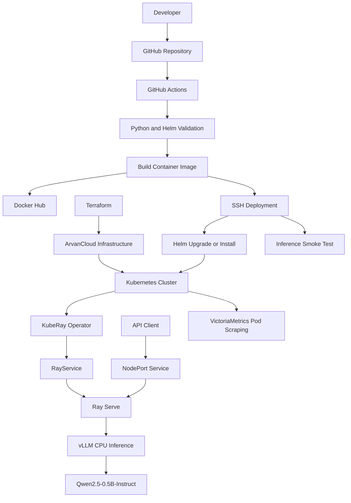

# AI Code — LLM Inference Platform

**A Cloud-Native LLM Inference Platform on Kubernetes**

[](https://www.terraform.io/)
[](https://kubernetes.io/)
[](https://www.ray.io/)
[](https://helm.sh/)
[](https://github.com/features/actions)

## Overview

AI Code is an infrastructure automation and LLM deployment project that provisions cloud infrastructure, deploys Kubernetes, and runs a CPU-based language model inference service.

The platform uses **Terraform** to provision infrastructure on ArvanCloud, **Kubespray** to bootstrap Kubernetes, and **KubeRay with Ray Serve and vLLM** to serve the Qwen2.5-0.5B-Instruct model.

A Helm chart manages the application deployment, while VictoriaMetrics Pod scraping configuration supports observability. GitHub Actions automates validation, container image publishing, deployment, and post-deployment smoke testing.

The project demonstrates practical engineering workflows across Infrastructure as Code, Kubernetes operations, containerization, model serving, monitoring, and CI/CD.

## Architecture



## Technology Stack

| Area | Technologies |
|---|---|
| Cloud | ArvanCloud |
| Infrastructure as Code | Terraform |
| Kubernetes provisioning | Kubespray |
| Container runtime | containerd |
| Container image | Docker |
| Distributed execution | Ray |
| Kubernetes integration | KubeRay Operator |
| Model serving | Ray Serve, vLLM |
| Language model | Qwen2.5-0.5B-Instruct |
| Deployment | Helm |
| Metrics scraping | VictoriaMetrics Operator |
| CI/CD | GitHub Actions |
| Container registry | Docker Hub |

## Repository Structure

```text
AI-Code/
├── .github/
│   └── workflows/
│       └── deploy.yml
├── app/
│   ├── .dockerignore
│   ├── Dockerfile
│   └── serve_app.py
├── helm/
│   └── qwen-llm/
│       ├── Chart.yaml
│       ├── values.yaml
│       └── templates/
│           ├── nodeport.yaml
│           ├── rayservice.yaml
│           └── vmpodscrape.yaml
├── terraform/
│   ├── main.tf
│   ├── provider.tf
│   ├── variables.tf
│   ├── outputs.tf
│   ├── terraform.tfvars
│   └── scripts/
│       ├── install-kubespray.sh
│       ├── kernel-tuning.sh
│       └── post-kubespray-master.sh
├── ai-usage.md
└── README.md
```

## Key Components

### 1. Infrastructure Provisioning

The Terraform configuration provisions the infrastructure required for a three-node Kubernetes cluster on ArvanCloud.

The intended topology is:

| Node | Role |
|---|---|
| `master` | Kubernetes control plane and cluster administration |
| `worker1` | Kubernetes worker |
| `worker2` | Kubernetes worker |

The infrastructure automation includes:

- Private network creation.
- Virtual machine provisioning.
- Public IP attachment.
- SSH connectivity checks.
- Kernel tuning.
- Kubespray installation orchestration.
- Preparation of the VictoriaMetrics data directory.
- Post-installation configuration on the master node.

Terraform configuration and provisioning scripts are located in `terraform/`.

### 2. Kubernetes Cluster

Kubespray is used to install and configure Kubernetes on the provisioned infrastructure.

The cluster provides the runtime environment for the Ray workloads, application networking, and monitoring configuration.

### 3. LLM Inference

The application in `app/serve_app.py` uses FastAPI, Ray Serve, and vLLM to serve the Qwen2.5-0.5B-Instruct model.

The container image is defined in `app/Dockerfile`. Model artifacts are included in the image to reduce dependence on downloading the model when the workload starts.

The implementation targets CPU-based inference; actual throughput and latency depend on available compute and memory resources.

### 4. Helm Deployment

The Helm chart in `helm/qwen-llm/` defines the deployment configuration:

- `rayservice.yaml` — RayService and Ray cluster configuration.
- `nodeport.yaml` — Kubernetes NodePort Service for accessing the inference API.
- `vmpodscrape.yaml` — VictoriaMetrics Pod scraping configuration.
- `values.yaml` — configurable image, Ray, resource, and service settings.

### 5. Monitoring

The `VMPodScrape` template configures metrics discovery and scraping for selected Ray Pods.

Successful collection depends on the VictoriaMetrics Operator being installed, the Pod selector matching actual labels, and the configured metrics endpoint being available.

The repository provides scrape configuration; dashboards and alerting depend on the monitoring components deployed alongside it.

### 6. CI/CD

The GitHub Actions workflow is located at `.github/workflows/deploy.yml`.

The intended pipeline covers:

1. Python syntax validation.
2. Helm chart linting.
3. Container image building.
4. Publishing the image to Docker Hub.
5. SSH-based deployment to the Kubernetes master.
6. Helm release upgrade or installation.
7. A smoke test against the inference endpoint.

Consult `deploy.yml` for the exact triggers, image tags, required secrets, and deployment behavior.

## Prerequisites

Before deploying the platform, prepare:

- An ArvanCloud account with sufficient resource quota.
- Terraform and the required ArvanCloud provider.
- SSH access to the provisioned nodes.
- Git, Python, and the dependencies required by the Kubespray installation script.
- Docker with BuildKit support.
- A Docker Hub repository and an access token with image-push permissions.
- A Kubernetes cluster with the KubeRay Operator installed before deploying the RayService chart.
- Helm 3.
- VictoriaMetrics Operator if Pod scraping is required.
- A GitHub repository with Actions enabled.

## Deployment Guide

### Step 1: Configure Terraform

Navigate to the Terraform directory:

```bash
cd terraform
```

Review `provider.tf`, `variables.tf`, `main.tf`, and `outputs.tf`.

Configure `terraform.tfvars` with the values required by the project, including cloud credentials or references, instance settings, networking, and SSH configuration.

**Security:** Do not commit real API tokens, passwords, or private keys. Keep local secret files out of version control.

### Step 2: Validate and Provision Infrastructure

```bash
terraform init
terraform fmt -recursive
terraform validate
terraform plan
```

Review the proposed changes before applying them:

```bash
terraform apply
```

Terraform may execute local or remote provisioning scripts as part of the workflow. Ensure the machine running Terraform has the dependencies and network access required by those scripts.

### Step 3: Build and Publish the Image

From the repository root:

```bash
docker build -t docker.io/<DOCKERHUB_USERNAME>/<IMAGE_NAME>:<TAG> ./app
docker login
docker push docker.io/<DOCKERHUB_USERNAME>/<IMAGE_NAME>:<TAG>
```

Replace the placeholders with the image repository and tag configured for your project.

### Step 4: Configure Helm Values

Edit `helm/qwen-llm/values.yaml` to set the image repository and tag, Ray version, resources, and NodePort.

Make sure the image's Ray version is compatible with the `rayVersion` configured in the chart.

### Step 5: Validate and Deploy the Chart

Validate the Helm chart:

```bash
helm lint helm/qwen-llm
helm template qwen-llm helm/qwen-llm \
  --namespace ai-inference
```

After confirming that the cluster and required operators are ready, deploy the release:

```bash
kubectl create namespace ai-inference \
  --dry-run=client -o yaml | kubectl apply -f -

helm upgrade --install qwen-llm helm/qwen-llm \
  --namespace ai-inference
```

If the CI/CD workflow supplies image overrides, use the same image repository and tag configured by that workflow.

### Step 6: Verify the Deployment

```bash
kubectl -n ai-inference get pods -o wide
kubectl -n ai-inference get services
kubectl -n ai-inference get rayservices
kubectl -n ai-inference get events --sort-by=.lastTimestamp
```

Review the RayService status and application logs if the service does not become ready.

## Inference API

The application exposes two HTTP endpoints.

### Text Generation

**Endpoint:** `POST /generate`

```bash
curl -X POST http://<NODE-IP>:30800/generate \
  -H 'Content-Type: application/json' \
  -d '{
    "prompt": "Explain Kubernetes in simple terms.",
    "max_new_tokens": 32
  }'
```

Example response:

```json
{
  "text": "Kubernetes is a platform for deploying and managing containerized applications..."
}
```

The `max_new_tokens` parameter accepts values from 1 to 64.

### Chat Completions

**Endpoint:** `POST /v1/chat/completions`

```bash
curl -X POST http://<NODE-IP>:30800/v1/chat/completions \
  -H 'Content-Type: application/json' \
  -d '{
    "messages": [
      {
        "role": "user",
        "content": "What is Infrastructure as Code?"
      }
    ],
    "max_tokens": 64
  }'
```

The application returns a simplified Chat Completions response structure. It does not claim full OpenAI API compatibility.

### Network Access

The example requests use NodePort `30800`. Replace `<NODE-IP>` with an address reachable from your client.

Ensure that cloud security groups and host firewall rules permit the required traffic. For production deployments, restrict exposure and add appropriate authentication and TLS.

## CI/CD Configuration

Configure the secrets referenced by `.github/workflows/deploy.yml` under:

**GitHub → Repository → Settings → Secrets and variables → Actions**

The workflow may require the following values, depending on its implementation:

| Secret | Purpose |
|---|---|
| `REGISTRY_USERNAME` | Registry username |
| `REGISTRY_PASSWORD` | Registry access token |
| `SSH_USER` | SSH user on the Kubernetes master |
| `MASTER_HOST` | Reachable master address |
| `SSH_PRIVATE_KEY` | Private key for SSH deployment |

Use the exact secret names referenced in `deploy.yml`. The deployment account must have the permissions needed to run the configured Kubernetes and Helm commands.

For a public Docker Hub image, Kubernetes does not need registry credentials to pull the image. Registry authentication is still required by the CI pipeline when publishing images.

## Troubleshooting

### Pods Are Pending

```bash
kubectl -n ai-inference describe pods
kubectl describe nodes
kubectl -n ai-inference get events --sort-by=.lastTimestamp
```

Check available CPU and memory, Pod resource requests, node conditions, and scheduling constraints.

### Image Pull Failures

Verify the configured repository and tag, and confirm that the image is accessible:

```bash
docker pull docker.io/<DOCKERHUB_USERNAME>/<IMAGE_NAME>:<TAG>
```

### RayService Is Not Ready

```bash
kubectl -n ai-inference get rayservices
kubectl -n ai-inference get pods
kubectl -n ai-inference describe rayservice qwen-llm
kubectl -n ai-inference logs <POD-NAME>
```

Check the image, model path, Ray version, Serve import path, and available worker resources.

### Metrics Are Missing

Verify that the VictoriaMetrics Operator is installed, the `VMPodScrape` selector matches actual Pod labels, and the selected metrics port serves `/metrics`.

## Security and Production Considerations

This project is a technical demonstration and should be hardened before production use.

Recommended improvements include:

- Restricting access to Kubernetes APIs and NodePort services.
- Adding API authentication and TLS.
- Managing credentials through a secure secret-management mechanism.
- Applying least-privilege permissions to deployment accounts.
- Pinning image tags to immutable versions.
- Scanning images for vulnerabilities.
- Implementing dashboards, alerting, and operational runbooks.
- Testing backup and recovery procedures.
- Adding load testing and inference performance benchmarks.

## AI Usage

See [`ai-usage.md`](ai-usage.md) for project-specific information about AI-assisted development.

## License

No license is specified in this repository. Add a `LICENSE` file before distributing the project or explicitly granting reuse permissions.

---

**Project focus:** Infrastructure as Code, Kubernetes automation, CPU-based LLM serving, observability, and CI/CD.